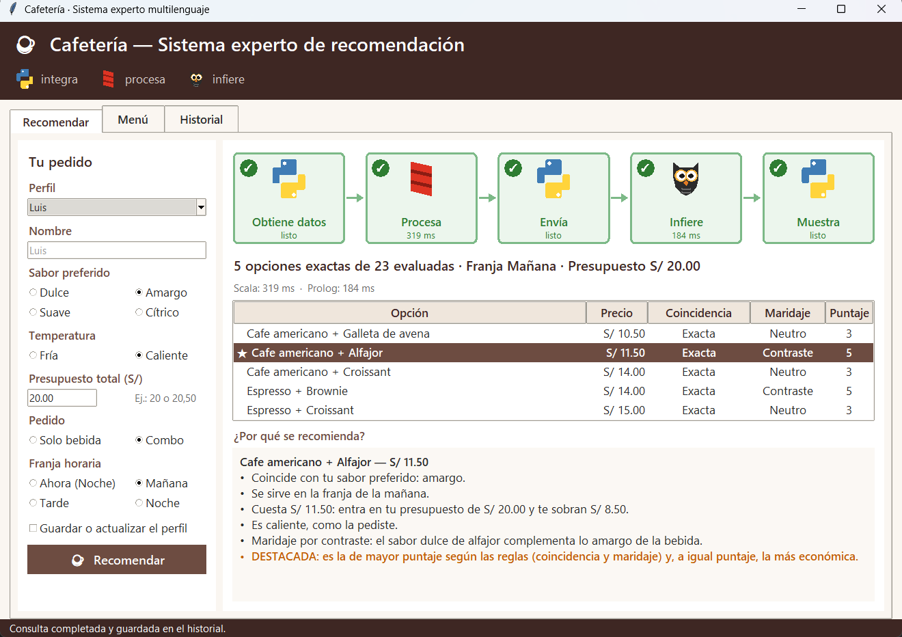

# Sistema experto de recomendación para una cafetería

**Avance 2 — Lenguajes de Programación.** Sistema experto multilenguaje que recomienda
bebidas y combos según el sabor y la temperatura preferidos, el presupuesto total y la
franja horaria, y explica cada recomendación.

| Lenguaje | Responsabilidad |
|---|---|
| **Python** | Integrador: interfaces (página web, ventana y consola), lectura y validación de `data/*.json`, comunicación con Scala y Prolog, historial |
| **Scala** | Lógica principal y procesamiento: valida la solicitud, determina la franja, arma todas las opciones y calcula sus precios |
| **Prolog** | Base de conocimiento e inferencia: coincidencia exacta o alternativa, maridaje, puntaje, opción destacada y motivos |

```text
USUARIO
   │
 Python ── 1. obtiene datos (data/*.json) y la solicitud
   │
   ├──► Scala ── 2. procesa: valida, franja, opciones y precios (JSON)
   │
 Python ── 3. envía a Prolog catálogo + precios de Scala + solicitud
   │
   ├──► Prolog ── 4. infiere: exacta/alternativa, maridaje, destacada (JSON)
   │
 Python ── 5. muestra el resultado y lo guarda en data/resultados.json
```

**Estado:** probado en Windows con Python 3.12, JDK 21, Scala 2.13.16 y SWI-Prolog 10.0.2:
44 pruebas Scala, 17 pruebas Prolog y 37 pruebas Python (20 de ellas ejecutan de verdad
el flujo completo con Scala y Prolog, 8 a través del servidor web). Evidencias en [`pruebas/`](pruebas/) y capturas en [`docs/capturas/`](docs/capturas/).



## Ejecutar

Requisitos: **Python 3.10+** (con tkinter, incluido en el instalador de python.org), **Java 21**,
y la carpeta `tools/` con Scala 2.13.16 y SWI-Prolog (ya incluida en esta PC). No se usa pip.

Desde la raíz del proyecto:

```powershell
py python/src/main.py --web        # página web con fotos (abre http://127.0.0.1:8000/)
py python/src/main.py              # interfaz gráfica (ventana tkinter)
py python/src/main.py --consola    # interfaz de texto
py scripts/probar_todo.py          # todas las pruebas (Scala, Prolog, Python)
```

También con el lanzador `.\scripts\cafeteria.ps1 -Accion Web|Interfaz|Consola|Probar|Demo|Compilar`
o desde VS Code con **Terminal › Run Task…** (la tarea de pruebas es **Ctrl+Shift+B**).

La primera vez Python compila Scala (unos segundos). Después solo recompila si cambian
los fuentes. Si SWI-Prolog está en otra ubicación, definir la variable `SWIPL` con la
ruta completa de `swipl.exe`.

## Interfaz web

`--web` levanta un servidor HTTP de la biblioteca estándar de Python (sin pip) que solo
escucha en `127.0.0.1`. El navegador habla únicamente con Python, que sigue siendo el
integrador: **Navegador → Python → Scala → Python → Prolog → Python → Navegador**.

- Pestañas *Recomendar*, *Carta* (con filtros por sabor) e *Historial*.
- Barra de flujo con el **símbolo de cada lenguaje** (Python, Scala, Prolog) que se ilumina
  paso a paso y muestra los milisegundos reales de Scala y Prolog.
- Opción destacada con sus motivos y tarjetas con la foto de la bebida y del acompañamiento.
- **Fotos reales:** se toman de `python/src/web/static/img/productos/<id>.jpg` (también
  `.png` o `.webp`), donde `<id>` es el código del producto en `productos.json`. Si un
  producto no tiene foto se dibuja una ilustración con el color de su sabor.
- Opciones: `--puerto 8080` para cambiar el puerto y `--sin-navegador` para no abrirlo.

API: `GET /api/catalogo`, `POST /api/recomendar`, `GET /api/historial`.

## Reglas del negocio (Prolog)

1. La bebida debe tener el sabor pedido y servirse en la franja elegida.
2. El precio total nunca supera el presupuesto (combo = bebida + acompañamiento).
3. Un combo solo usa acompañamientos compatibles con la bebida (`combina/2`).
4. Si hay coincidencias exactas (también la temperatura), solo se muestran esas.
5. Solo si no hay ninguna exacta, se ofrecen **alternativas de temperatura**, marcadas y explicadas.
6. **Maridaje** del combo: *armonía* (mismo sabor), *contraste* (sabores que se complementan,
   p. ej. amargo + dulce) o *neutro*.
7. **Puntaje**: exacta = 3, armonía o contraste = 2. La **destacada** es la de mayor puntaje;
   a igual puntaje, la más económica.
8. Las opciones se listan de menor a mayor precio.

Franjas: mañana 06:00–11:59, tarde 12:00–18:59, noche 19:00–05:59 (las calcula Scala desde la hora).

## Ejemplos para la demostración (catálogo actual, presupuesto S/ 20,00)

| Perfil | Pedido | Franja | Resultado |
|---|---|---|---|
| Luis (amargo, caliente) | Combo | Mañana | 5 exactas; destacada **Café americano + Alfajor S/ 11.50** (contraste) |
| Ana (dulce, fría) | Combo | Tarde | 4 exactas; destacada **Milkshake de vainilla + Alfajor S/ 15.50** (armonía) |
| Sofía (suave, fría) | Combo | Mañana | 5 **alternativas** calientes; destacada Café latte + Galleta de avena S/ 13.00 |
| Carlos (amargo, fría) | Solo bebida, S/ 15 | Tarde | Cold brew S/ 11.00, exacta |
| Ana (dulce, fría) | Solo bebida | Mañana | Sin opciones: no hay bebidas dulces en la mañana |

## Prolog por separado

```text
cd prolog
..\tools\swipl\bin\swipl.exe consultas.pl
?- demo.
?- recomendaciones(cliente_1, tarde, 2000, combo, R).
?- recomendaciones(solicitud(amargo, fria, 1500, sola, tarde), R).
?- maridaje(cold_brew, alfajor, M).
```

`prolog/hechos.pl` lo **genera Python** desde los JSON (`py python/src/main.py --exportar-hechos`).
Montos en céntimos: `2000` = S/ 20,00.

## Estructura

```text
data/            productos.json, clientes.json, resultados.json (historial)
python/src/      main.py
  integracion/   integrador.py, scala_service.py, prolog_service.py, errores.py
  modelos/       cliente.py, producto.py, recomendacion.py
  utils/         archivos.py (JSON y hechos), formato.py, herramientas.py (Java, Prolog, compilar)
  interfaz/      ventana.py (tkinter), flujo.py (logos dibujados), consola.py
  web/           servidor.py (API), static/ (index.html, estilos.css, app.js, img/)
python/tests/    test_archivos.py, test_integracion.py, test_web.py
scala/src/main/scala/app/
  Main.scala
  modelos/       Preferencias.scala, Producto.scala, Solicitud.scala
  servicios/     EntradaService, ProcesamientoService, JsonService, Validacion, Funciones
scala/src/test/  Pruebas.scala
prolog/          hechos.pl (generado), reglas.pl, recomendaciones.pl, consultas.pl, pruebas.pl
docs/            arquitectura.md, manual_usuario.md, CAMBIOS_Y_AUDITORIA.md, capturas/
pruebas/         prueba_scala.md, prueba_prolog.md, prueba_integracion.md
scripts/         probar_todo.py, cafeteria.ps1
```

## Alcance

Es un recomendador, no un sistema de ventas: no cobra, no registra pedidos ni descuenta
stock, y no aprende del historial. No usa IA generativa ni interpreta texto libre.
Los perfiles nuevos se guardan en `clientes.json` solo si el usuario lo marca.
