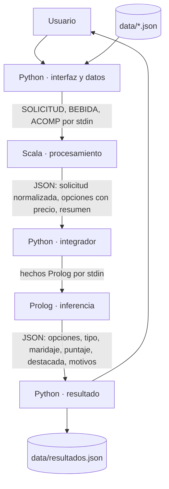
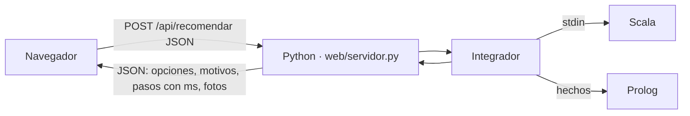
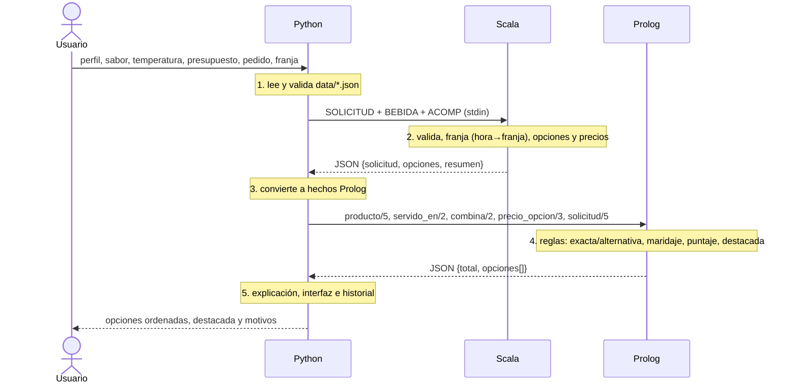
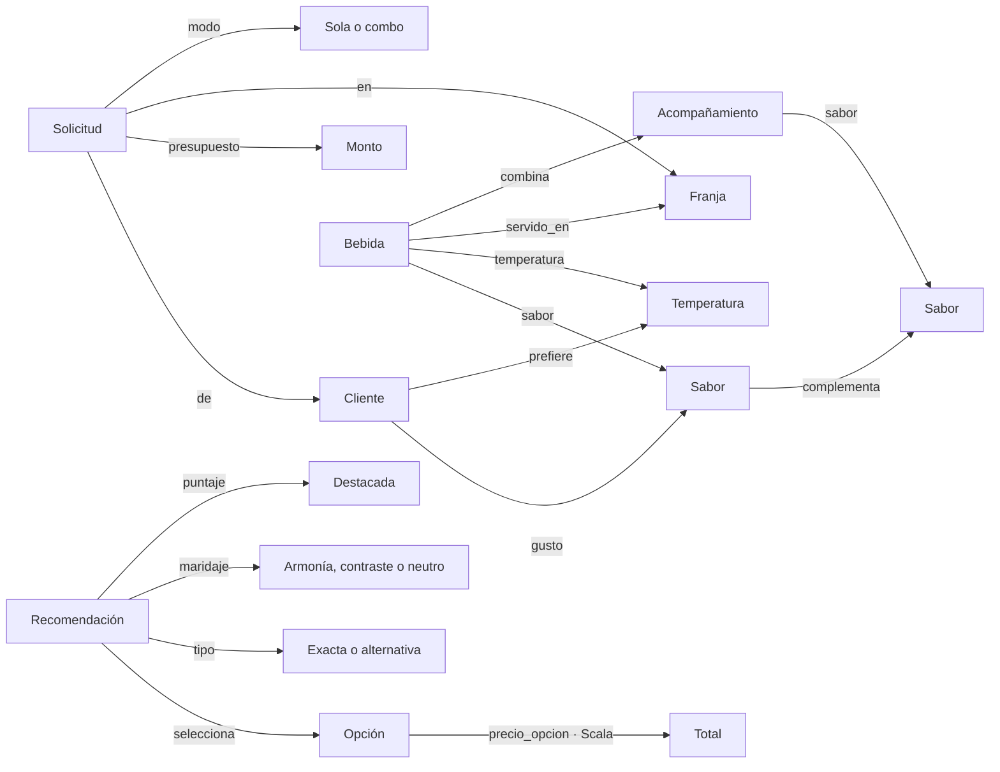

# Arquitectura del sistema

## 1. Vista general



| Tecnología | Responsabilidad | Archivos principales |
|---|---|---|
| Python | Integración, datos, comunicación, interfaz e historial | `python/src/integracion/integrador.py` |
| Scala | Lógica principal y procesamiento (validar, franja, opciones, precios, resumen) | `scala/.../servicios/ProcesamientoService.scala` |
| Prolog | Base de conocimiento e inferencia | `prolog/reglas.pl`, `prolog/recomendaciones.pl` |

**Decisión clave:** solo Python lee `data/`. Scala y Prolog reciben la información ya
validada. En el avance 1 Scala y Prolog leían los CSV por separado con reglas distintas,
y un dato aceptado por uno podía romper al otro (ver `CAMBIOS_Y_AUDITORIA.md`).

## 2. Diseño de módulos

### Python (`python/src`)
| Módulo | Función |
|---|---|
| `main.py` | Punto de entrada: ventana, `--web`, `--consola` o `--exportar-hechos` |
| `integracion/integrador.py` | Clase `Integrador`: ejecuta los 5 pasos, mide tiempos y guarda el historial |
| `integracion/scala_service.py` | Arma el mensaje para Scala, ejecuta la JVM e interpreta el JSON |
| `integracion/prolog_service.py` | Convierte los datos en hechos Prolog, ejecuta SWI-Prolog e interpreta el JSON |
| `modelos/` | `Cliente`, `Bebida`, `Acompanamiento`, `Catalogo`, `Solicitud`, `Opcion`, `ResultadoConsulta` (dataclasses) |
| `utils/archivos.py` | Lectura y validación de JSON, guardado atómico, generación de `hechos.pl` |
| `utils/formato.py` | Montos (`S/ 18.50`) y explicación de los motivos inferidos por Prolog |
| `utils/herramientas.py` | Ubica Java y SWI-Prolog y compila Scala solo si cambió algún fuente |
| `interfaz/ventana.py`, `interfaz/consola.py` | Ventana tkinter y consola sobre el mismo integrador |
| `interfaz/flujo.py` | Dibuja en un `Canvas` los símbolos de Python, Scala y Prolog y la barra de pasos |
| `web/servidor.py` | Servidor HTTP (`http.server`) y API JSON: `/api/catalogo`, `/api/recomendar`, `/api/historial` |
| `web/static/` | Página: `index.html`, `estilos.css`, `app.js`, logos de los lenguajes y fotos de productos |

### Scala (`scala/src/main/scala/app`)
| Archivo | Función |
|---|---|
| `Main.scala` | Lee stdin, llama a los servicios y responde una línea JSON (código 2 si la solicitud es inválida) |
| `modelos/Preferencias.scala` | `Sabor`, `Temperatura`, `Modo`, `Franja` (sealed traits) y `Franja.deHora` |
| `modelos/Producto.scala` | `Bebida`, `Acompanamiento`, `Catalogo` (con un `Map` por id) |
| `modelos/Solicitud.scala` | `Solicitud`, `OpcionPrecio`, `Resumen`, `ResultadoProcesamiento` |
| `servicios/EntradaService.scala` | Interpreta cada registro con *pattern matching* y valida referencias |
| `servicios/ProcesamientoService.scala` | Genera opciones (`map`, `flatMap`, `filter`), ordena y resume (`groupBy`) |
| `servicios/Validacion.scala` | Montos a céntimos, identificadores y `todos` (lista de `Either` → `Either` de lista) |
| `servicios/Funciones.scala` | Funciones genéricas de orden superior: `filtrar`, `ordenarPor`, `contarPor` |
| `servicios/JsonService.scala` | Escritor JSON con escape de caracteres, sin bibliotecas externas |

### Prolog (`prolog/`)
| Archivo | Función |
|---|---|
| `hechos.pl` | Base de conocimiento generada desde los JSON (productos, horarios, combinaciones, clientes) |
| `reglas.pl` | `candidata/4`, `exacta/4`, `recomendar/2`, `maridaje/3`, `complementa/2`, `puntaje/2`, `motivos/3` |
| `recomendaciones.pl` | `recomendaciones/2` y `/5` (todas, ordenadas), `destacada/2`, mensajes de error |
| `consultas.pl` | `cli/0` (modo integrado), `demo/0` y cálculo local de precios para el uso independiente |
| `pruebas.pl` | 17 pruebas PlUnit con un catálogo propio |

### Interfaz web



El servidor usa solo la biblioteca estándar, escucha únicamente en `127.0.0.1`, limita el
cuerpo de la petición a 10 KB, valida cada campo con las mismas listas de valores que la
ventana y no permite leer archivos fuera de `web/static` (ni `data/`). Atiende una consulta a
la vez (`threading.Lock`), porque todas comparten el historial.

## 3. Flujo del sistema



## 4. Modelo de datos

**`data/productos.json`**
```json
{ "bebidas": [ { "id": "espresso", "nombre": "Espresso", "sabor": "amargo",
                 "temperatura": "caliente", "precio": "8.00",
                 "franjas": ["manana", "tarde"], "acompanamientos": ["croissant", "brownie"] } ],
  "acompanamientos": [ { "id": "brownie", "nombre": "Brownie", "sabor": "dulce", "precio": "6.00" } ] }
```
**`data/clientes.json`**: `[{"nombre": "Ana", "sabor": "dulce", "temperatura": "fria"}]`

**`data/resultados.json`**: últimas 200 consultas (fecha, cliente, pedido, franja, presupuesto,
opciones y destacada).

Reglas de los datos: identificadores en minúsculas (`[a-z][a-z0-9_]*`); sabores
`dulce|amargo|suave|citrico`; temperaturas `fria|caliente`; franjas `manana|tarde|noche`;
precios como texto con hasta 2 decimales (se evita `float`). Los archivos pueden tener BOM.

## 5. Comunicación entre lenguajes

Ambos procesos se ejecutan con `subprocess.run` (lista de argumentos, sin shell), entrada
por **stdin** y respuesta en **stdout**; los errores van por **stderr** y por el código de
salida, así un aviso nunca se mezcla con la respuesta. Tiempo máximo: Scala 30 s, Prolog 15 s.

**Python → Scala** (un registro por línea):
```text
SOLICITUD|amargo|caliente|15.00|combo|manana        (o hora=20 para la franja automática)
BEBIDA|espresso|amargo|caliente|8.00|manana;tarde|croissant;brownie
ACOMP|brownie|dulce|6.00
```
**Scala → Python:**
```json
{"solicitud":{"sabor":"amargo","temperatura":"caliente","presupuesto":1500,"modo":"combo",
 "franja":"manana","franja_automatica":false},
 "opciones":[{"bebida":"espresso","acompanamiento":"brownie","total":1400}, ...],
 "resumen":{"opciones_generadas":3,"precio_minimo":1400, ...}}
```
**Python → Prolog** (hechos; Prolog solo acepta estos 5 predicados y nunca ejecuta objetivos):
```prolog
producto(espresso,bebida,amargo,caliente,800).
servido_en(espresso,manana).
combina(espresso,brownie).
precio_opcion(espresso,brownie,1400).      % calculado por Scala
solicitud(amargo,caliente,1500,combo,manana).
```
**Prolog → Python:**
```json
{"total":2,"opciones":[{"tipo":"exacta","bebida":"espresso","acompanamiento":"brownie",
 "total":1400,"maridaje":"contraste","puntaje":5,"destacada":true,
 "motivos":["sabor_coincide","servida_en_franja","dentro_del_presupuesto",
            "temperatura_exacta","maridaje_contraste"]}]}
```
Seguridad: solo se envían a Prolog códigos validados (`[a-z][a-z0-9_]*`) y enteros. El
nombre del cliente nunca llega a Scala ni a Prolog.

## 6. Red semántica


